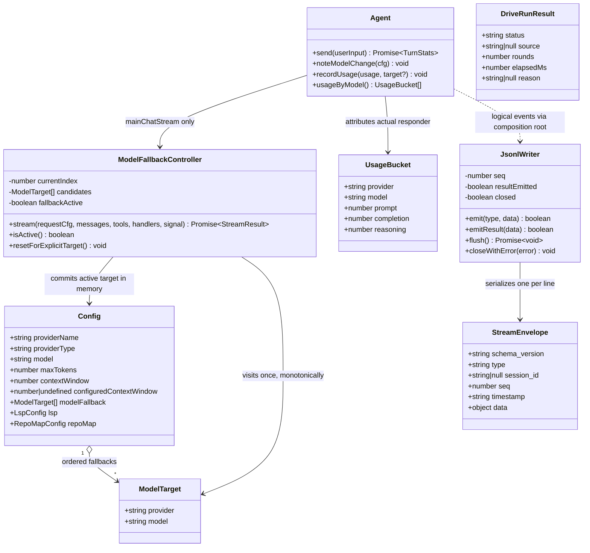
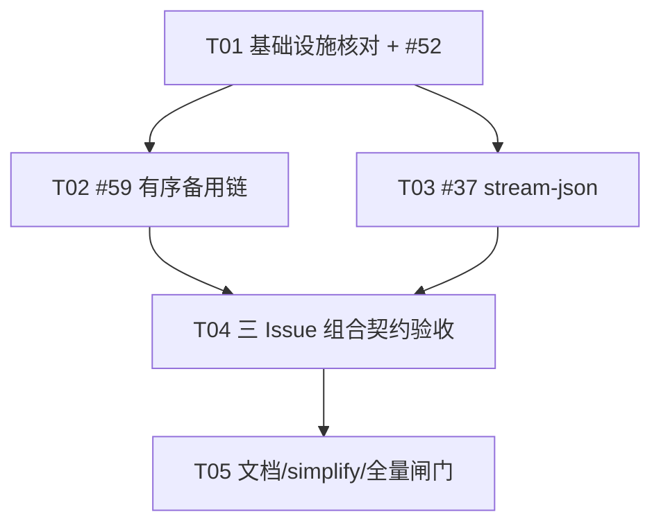

# neo-agent 2026-11-14 核心 Issue 增量架构

> 状态：技术方案，尚未实现  
> 基线：`main = v0.4.84 = a2858ae`  
> 产品输入：`docs/neo-agent-iteration-2026-11-14-prd.md` §4、§7、§8  
> 范围：仅 #52、#59、#37；不包含 Web 实现、其它 Issue、发布或 Issue 关闭。  
> 本文中的新字段、事件名、退出行为和文件任务为本次定稿；实现与文档不得另起同义契约。

## 0. 决策摘要

1. **#52 先做**：默认值改为关闭，同时让 LSP 的 schema、工具名和提示词说明使用同一个 `cfg.lsp.enabled` 判断；repo map 复用已有关闭短路。`driveExitCode()` 改为 verified=0、model=3、未达成=1，组合根继续保持 SIGINT=130、用法错误=2、LLM/Agent 硬错误=1。
2. **#59 不重写 `chatStream()`**：新增会话级 `ModelFallbackController`，只包装主 Agent 的单次模型请求。每个候选内部仍由现有 `chatStream()` 完成同模型重试、协议端点回退和受控参数降级；耗尽或明确模型级失败后才进入下一个候选。
3. **备用链与旧路由降级完全分离**：新 settings 字段为顶层 `model_fallback`，CLI 为可重复 `--fallback <provider>:<model>`，以及 `--no-fallback`；不改写、不复用 `model_routes.*.fallback_allowed`。
4. **会话内单调前进**：候选游标只会向后移动；成功切换后保留目标，不做健康探测、自动回切或 settings 写回。自动分类在 fallback 保持期间不得把模型切走；显式 `/model`、`/provider`、`/tier` 后由下一次请求边界识别新身份并重置链。
5. **#37 使用独立 JSONL writer**：新增 `src/streamJson.ts`，统一信封版本为字符串 `"1.0"`；正文只发完整 `assistant_message`，不发 token delta，不发 reasoning/thinking。stdout 只归 writer，所有 Console/诊断继续走 stderr。
6. **最终事件单出口**：正常和已捕获失败均恰好一个 `result`；EPIPE/stdout 写失败是无法交付该事件的明确例外，取消工作、清理资源、退出 1，不重试写 stdout。
7. **无新依赖**：继续 Bun + TypeScript strict + 运行时零第三方依赖。

# Part A：System Design

## 1. Implementation Approach

### 1.1 技术难点与架构选择

| 难点 | 已确认代码事实 | 增量方案 |
| --- | --- | --- |
| 默认关闭不等于能力不可见 | `TOOLS` 静态包含 `lspTool`；`src/system-prompt.ts` 另有硬编码 `lsp` 行 | 保留实现和注册表，在所有面向模型/用户的可见性出口按 `cfg` 过滤；提示词说明条件渲染 |
| repo map 不能仅不显示文本 | `buildRepoMap()` 已有 disabled 短路 | 只改默认配置，复用短路，确保关闭时不进入扫描 |
| drive 来源已有，无需改状态机 | `DriveRunResult.source` 已是 `verified/model/null` | 只改纯退出映射及单次模式优先级；交互 `/drive` 不动 |
| 同模型重试与跨模型切换不能混杂 | `chatStream()` 已负责重试、退避、超时、协议回退；部分流中断为不可重试 | 在主 Agent 请求外层做有限候选遍历；不把候选循环塞进协议循环 |
| 已输出增量后不能换模型重放 | `partialInterrupt()` 已防止同模型重复输出 | controller 为每个候选包装 handlers；任一 reasoning/content/tool 增量出现后失败即原样失败，禁止切换 |
| 跨协议历史 | 内部为 OpenAI 风格 `Message[]`；OpenAI 剥离 `thinking_blocks`，Anthropic 走 `anthropicWire.ts` | 直接复用 `chatStream()` 和 `anthropicWire.ts`，不新增第二套消息转换器 |
| 目标窗口/预算不能继承源模型 | `resolveAndApplyModelWindow()` 使用 `configuredContextWindow` 防止旧窗口泄漏 | 构造目标 cfg 时重新赋 provider 字段、显式 model、provider/global 默认预算，再解析目标窗口 |
| 会话保持与自动分类冲突 | `classifyTurn()` 每轮可能调用 `applyTier()` | fallback active 时跳过自动分类；显式切换造成 cfg 身份变化时，下一请求边界重置 controller |
| 用量不能全记到最终模型 | 当前只有累计总数，没有 provider/model 分桶 | 保留原累计字段，新增按 `provider|model` 的账本；每次响应按实际返回它的目标记账 |
| JSONL 不能被普通 UI 污染 | 现有 `jsonMode` 已把 Console 写往 stderr | 扩展为 `structuredMode = json || stream-json`；stream-json 正文只经 `JsonlWriter` |
| 工具配对与有界载荷 | 当前 `tool_start/tool_end` 没有 call id/output | 扩展内部事件为含 `call_id`、paths、output 的载荷；writer 做统一脱敏和截断 |
| EPIPE 与最终 flush | 文件末尾直接 `process.exit(await main())`，无统一顶层 catch | writer 监听 write error、标记 closed、取消 agent；`result` 后等待有界 flush；不在已关闭管道上补写 |

### 1.2 架构模式

- **组合根装配**：`src/index.ts` 继续负责配置、session、Agent、fallback controller、JSONL writer 和资源清理的接线。
- **依赖注入**：主 Agent 新请求入口经 `AgentOptions.mainChatStream` 注入；既有 `chatStream` 注入仍供测试及 compact/judge 等既有路径使用。
- **会话级状态机**：`ModelFallbackController` 持有当前候选下标和保持状态，不使用模块级全局健康状态。
- **单向事件适配**：`AgentEvent` 是内部逻辑事件；`streamJson.ts` 是唯一外部 v1 schema 映射与序列化边界。text/json 不经过该适配器。
- **纯逻辑可测**：配置解析、错误归因、目标切换、截断/脱敏、退出码分别保持为可独立测试的函数。

## 2. File List

### 2.1 新增文件

| 相对路径 | 责任 |
| --- | --- |
| `src/modelFallback.ts` | #59 会话级候选遍历、错误归因、目标 cfg 构造、脱敏失败摘要、成功提交 |
| `src/streamJson.ts` | #37 v1 类型、seq/timestamp、工具载荷脱敏/截断、JSONL 写入、result 单次保护、flush/EPIPE |
| `tests/model-fallback.test.ts` | #59 解析、顺序、归因、跨协议 fake、能力/预算、会话保持、用量和日志测试 |
| `tests/cli-stream-json.test.ts` | #37 真 CLI JSONL、事件配对、截断、用法错误、SIGINT、EPIPE 与组合场景 |

### 2.2 修改文件

| 相对路径 | 修改范围 |
| --- | --- |
| `src/config.ts` | #52 默认值；#59 `ModelTarget`、`Config.modelFallback`、严格 settings/CLI target 解析、`applyModelTarget()` |
| `src/oneshotDrive.ts` | `driveExitCode()` 的 0/3/1 映射和注释；不改摘要函数 |
| `src/tools/index.ts` | 保留 LSP 实现；`toolSpecs/toolNames/mainToolNames` 按 cfg 过滤可见性 |
| `src/system-prompt.ts` | 工具名传 cfg；`lsp` 描述仅在 enabled 时出现；repo map 继续复用现有短路 |
| `src/prompt/manager.ts` | 确保工具可见性估算/指纹与实际 cfg 过滤后的工具集一致 |
| `src/prompt/visibility.ts` | 接受或获得同一可见工具集，避免 dry-run 与真实 schema 漂移 |
| `src/agent/types.ts` | 新主请求注入、新内部事件载荷、fallback active 查询、分桶用量类型 |
| `src/agent/loop.ts` | 主请求与 compact 分流；turn/assistant/tool 事件；fallback 后提示词同步；按实际模型记 usage |
| `src/cli/commands.ts` | `/cost` 保留总量并增加实际 provider/model 分桶；`/tools` 使用 cfg 可见集 |
| `src/cli/help.ts` | #52 退出码、#59 CLI、#37 stream-json 最小用法和限制 |
| `src/index.ts` | 新参数解析与校验、controller/writer 装配、stdout/stderr 分流、SIGINT、drive/result/exit 组合 |
| `settings.example.json` | 默认关闭示例、`model_fallback` 有序链示例，与旧 `fallback_allowed` 并排说明差异 |
| `README.md` | 当前行为、配置、事件表、schema 示例、退出码、截断/保密/EPIPE/消费示例 |
| `docs/oneshot-drive-prd[done].md` | 将当前行为从 model done=0 修为 3；保留历史背景但明确现行契约 |
| `docs/repo-map-prd[done].md` | 默认开启改为默认关闭及显式开启方式 |
| `docs/lsp-prd[done].md` | 默认关闭、显式 `enabled:true`、关闭时 schema/prompt 不可见 |
| `docs/release-notes/<下一实际版本>.md` | 仅版本确定后新增；记录行为变化、实际验证数字，不回填/篡改旧 release note |

### 2.3 测试修改文件

- `tests/oneshot-drive.test.ts`：52-C…F、52/59/37 的 drive 组合。
- `tests/repo-map.test.ts`：52-A/B 的默认关闭、显式覆盖、不扫描/不注入及开启后原能力。
- `tests/lsp.test.ts`：52-A/B 的显式开启后 fake LSP 回归。
- `tests/prompt-manager.test.ts`、`tests/prompt-visibility.test.ts`：LSP schema、工具名和提示词可见性一致。
- `tests/llm-retry.test.ts`：确认同模型重试、abort、部分流中断语义未被 fallback 改写。
- `tests/cli-json.test.ts`：37-C 的 text/单行 json 原契约回归。
- `tests/model-switch-refresh.test.ts`、`tests/model-capabilities.test.ts`：目标窗口/能力重算回归。

### 2.4 明确复用但不要求改写

- `src/llm.ts`：同模型重试、错误对象、流式边界、OpenAI/Anthropic 请求。
- `src/anthropicWire.ts`：跨协议历史和工具 id 适配。
- `src/env/modelWindows.ts`：`resolveAndApplyModelWindow()` / `refreshCapabilitiesAfterModelSwitch()`。
- `src/prompt/repoMap.ts`：disabled 时不扫描并返回空图。
- `src/lsp/index.ts`：disabled 时不 configure/start server。
- `src/session.ts`：`SessionMeta.id` 是正常运行事件的唯一 `session_id` 来源。
- `src/cleanup.ts`：所有单次模式退出继续使用既有资源清理路径。

## 3. Data Structures and Interfaces

### 3.1 类与关系



### 3.2 #52 接口与行为

```ts
export const DEFAULT_LSP: LspConfig = {
  enabled: false,
  servers: [],
  diagnosticsTimeoutMs: 1_500,
};

export const DEFAULT_REPO_MAP: RepoMapConfig = {
  enabled: false,
  budgetTokens: 800,
  maxFiles: 1_200,
};

export function driveExitCode(result: DriveRunResult): number;
```

`driveExitCode()` 真值表：

| status | source | exit |
| --- | --- | ---: |
| `done` | `verified` | 0 |
| `done` | `model` | 3 |
| `done` | `null` | 1（防御性，不把无来源达成当成功） |
| `exhausted` / `idle-stop` / `timeout` | 任意 | 1 |

单次模式总优先级固定为：

1. `stats.aborted` → 130；
2. `stats.hadError` → 1，即使检查碰巧通过也不得覆盖硬错误；
3. 有 drive 结果 → `driveExitCode(driveResult)`；
4. 普通成功 → 0；
5. 参数/配置/模式组合用法错误 → 2。

`formatDriveSummary()` 的字段和顺序保持：`[drive] status=<s> source=<s> rounds=<n> elapsed=<n>s`，reason 行也保留现状。

LSP 可见性统一为：

```ts
function lspVisible(cfg: Config): boolean {
  return cfg.lsp?.enabled === true;
}
```

- `Agent.toolSpecsFor()`、`mainToolNames(cfg)`、`toolNames(cfg)`、`/tools`、prompt visibility 和硬编码说明均使用该事实。
- 不从 `TOOLS` 删除 `lspTool`，避免破坏 dispatch、测试和显式开启。
- repo map 的 `enabled:false` 必须在任何文件枚举前返回，不能只把最终 `map.text` 置空。

### 3.3 #59 配置与 CLI 定稿

settings 只接受**对象数组**，不接受字符串简写、对象map或旧字段别名：

```json
{
  "model_fallback": [
    { "provider": "backup-openai", "model": "gpt-backup" },
    { "provider": "backup-anthropic", "model": "claude-backup" }
  ]
}
```

CLI：

```sh
neo -p "任务" \
  --fallback backup-openai:gpt-backup \
  --fallback backup-anthropic:claude-backup

neo -p "任务" --no-fallback
```

规则：

- `--fallback <provider>:<model>` 与 `--fallback=<provider>:<model>` 等价；可重复，出现顺序就是优先级。
- 任一 `--fallback` 出现时，本次运行**完整替换** settings 链，不做 append/merge。
- `--no-fallback` 等价于本次空链；与 `--fallback` 同现为用法错误 2。
- settings 缺省或 `[]` = 禁用。settings 非数组、项非对象、缺字段、空字符串、未知 provider、未实现协议、重复 `provider+model` 均为 `ConfigError`，在模型请求前失败；CLI 对应错误退出 2。
- CLI 在第一个 `:` 分割，两侧 trim 后必须非空；provider 名本身含 `:` 不支持，避免二义。
- 链内比较对 provider/model 均大小写敏感，只 trim 外围空白；最多 8 个备用项，防止误配造成超长故障遍历。
- 运行构造候选时，当前主模型是 index 0；若备用项与当前主模型相同，该项跳过，不重复请求。链内重复仍在解析期报错。
- `model_routes.<tier>.fallback_allowed` 只保留现有“档位目标协议不可用时向 default 降级”语义；controller 不读取它，README 不用它解释 #59。

关键接口：

```ts
export interface ModelTarget {
  provider: string;
  model: string;
}

export interface FallbackFailure {
  target: ModelTarget;
  code:
    | "network"
    | "timeout"
    | "rate_limit"
    | "server"
    | "model_unavailable"
    | "model_forbidden";
  message: string; // 已脱敏，最多 240 个 Unicode code points
}

export interface ModelFallbackEvent {
  from: ModelTarget;
  to: ModelTarget;
  reason: FallbackFailure;
  attempts: FallbackFailure[];
}

export function parseFallbackTarget(
  text: string,
  providers: ProviderConfig[],
): ModelTarget;

export function applyModelTarget(cfg: Config, target: ModelTarget): void;

export class ModelFallbackController {
  constructor(opts: {
    cfg: Config;                         // 会话共享对象
    fallbacks: readonly ModelTarget[];
    stream?: typeof chatStream;          // 测试注入，缺省 chatStream
    onFallback?: (e: ModelFallbackEvent) => void;
    onNotice?: (message: string) => void;
  });
  get isActive(): boolean;
  stream(
    requestCfg: Config,
    messages: Message[],
    tools: ToolSpec[],
    handlers?: StreamHandlers,
    signal?: AbortSignal,
  ): Promise<StreamResult>;
}
```

`AgentOptions` 增量：

```ts
mainChatStream?: typeof chatStream; // 仅 loop 的主 Agent 请求使用
isFallbackActive?: () => boolean;   // true 时 classifyTurn 不自动改路由
```

`compactNow()`、judge、classifier、memory、subagent 继续走既有 `streamFn/chatStream`，不自动获得各自独立备用链。生产组合根只给主 Agent 注入 `mainChatStream`。

### 3.4 #59 错误归因与候选状态

判定顺序不可颠倒：

1. `signal.aborted` 或 `AbortError` → 不切换。
2. 本候选已向任何流 handler 发出 reasoning/content/tool 增量 → 不切换。
3. 上下文超长、普通参数错误、工具/检查错误 → 不切换。
4. 明确的模型不存在/无权限 → 可提前切换，无需耗尽同模型重试。
5. 网络、connect/idle timeout、408/409/425/429、5xx 在 `chatStream()` 内完成同模型重试；最终仍失败才切换。
6. 其它错误 → 不切换。

| 错误 | fallback | 依据 |
| --- | --- | --- |
| 无 HTTP status 的连接/DNS/socket 错误 | 同模型重试耗尽后切换 | `network` |
| connect/idle timeout | 同模型重试耗尽后切换 | `timeout` |
| 408/409/425/429 | 同模型重试耗尽后切换 | `rate_limit`（429）或 `server`/既有类别 |
| 5xx | 同模型重试耗尽后切换 | `server` |
| 404 + 结构化 `model_not_found` 或明确“该 model 不存在” | 可立即切换 | `model_unavailable` |
| 401/403 + 结构化模型级权限码，或同时明确指向该 model 的无权限文案 | 可立即切换 | `model_forbidden` |
| 裸 400/401/403/404、无效 API key、普通鉴权失败、endpoint 不存在 | 不仅凭 status 切换 | 原错误 |
| context overflow、max_tokens 普通参数问题 | 不切换 | 交由现有恢复/错误路径 |
| 部分流中断 | 不切换 | 避免重复正文/工具 |
| 用户中断、工具失败、drive 检查失败 | 不切换 | 非模型网关故障 |

“明确模型级”优先使用响应 JSON 的 `error.code/error.type`；仅当文本同时包含 model 语义和 not-found/no-access 语义时才用保守正则。不得把完整 body 写进事件或日志。

候选规则：

- 每次主请求从 `currentIndex` 开始，只访问其后的候选；成功后该下标成为会话当前位置。
- 失败候选在本会话链中不重访；没有循环、随机、健康缓存和自动回切。
- 首个备用失败、第二个成功时只发一个成功 `model_fallback`，`attempts` 按顺序包含所有失败摘要。
- 全部失败时抛 `LLMError` 兼容的 exhausted 错误，message 含按序脱敏摘要；主 Agent 按既有 `hadError=1` 收口。
- 只有目标完整响应成功后才把目标写进共享 cfg；失败候选不改变当前模型。
- 普通请求最大模型候选数为 `1 + min(8, fallbackCount)`；每个候选的普通 HTTP 尝试仍受既有 `retry.maxAttempts` 限制，协议/参数降级也保持既有有限次数。

### 3.5 目标配置、提示词和用量

`applyModelTarget()` 必须在请求目标前设置：

- `providerName/providerType/apiKey/baseUrl/model`；
- `maxTokens = targetProvider.maxTokens ?? globalDefaults.maxTokens`；
- `temperature = targetProvider.temperature ?? globalDefaults.temperature`；
- `contextWindow/configuredContextWindow/contextWindowSource/configuredContextWindowExplicit` 按目标 provider 与 globalDefaults 重算；
- `modelTier` 保留当前展示档位，但 fallback 身份优先于档位路由，类似显式 `/model` 的“绕过档位”。

随后对目标 cfg 调用 `resolveAndApplyModelWindow()`。不得复制来源模型的 `maxTokens`、窗口、base URL、key、协议或 output-limit 学习结果；`chatStream()` 现有学习键 `provider|baseUrl|model` 继续隔离。

成功返回后主循环在 `requestInFlight=false` 的安全边界检测请求前后 `provider|model` 变化，调用 `noteModelChange(cfg)`；当前响应仍属于刚完成请求，下一主请求使用新系统提示词。`refreshCapabilitiesAfterModelSwitch()` 可复用现有事实刷新，但 fallback 本身不得写 settings。

用量类型：

```ts
export interface UsageBucket {
  provider: string;
  model: string;
  prompt: number;
  completion: number;
  reasoning: number;
}
```

- 每次 `res.usage` 在成功响应返回后立即按实际 cfg 身份记 bucket；累计 `prompt/completion/reasoning` 保留不变。
- compact/judge 等既有 `recordUsage()` 也按调用时实际模型记 bucket，但不因此获得独立 fallback。
- `/cost` 展示总量和逐模型分项；最终实际 provider/model 取当前成功目标。
- 既有单行 `json` payload 不新增必需字段、不改既有消费契约；其 `model/provider` 因共享 cfg 自然反映实际目标。
- 新会话或 `--resume` 新进程从重新解析的配置开始；fallback 目标不持久化到 session/settings。

### 3.6 #37 v1 统一信封

```ts
export const STREAM_JSON_SCHEMA_VERSION = "1.0" as const;

export interface StreamEnvelope<T extends StreamEventType = StreamEventType> {
  schema_version: "1.0";           // 字符串，不用 number
  type: T;                         // 下表事件名
  session_id: string | null;       // 正常运行为 SessionMeta.id；会话创建前用法错误为 null
  seq: number;                     // 安全整数，从 1 开始，每行严格 +1
  timestamp: string;               // new Date().toISOString()，UTC RFC 3339/ISO 8601
  data: StreamEventData[T];        // 始终为 JSON object，不允许 null/数组/缺省
}
```

一行是 `JSON.stringify(envelope) + "\n"`；不输出数组括号、逗号、banner、ANSI 控制字节或人类诊断。JSON 内字符串的换行/控制字符由 JSON 转义。

### 3.7 #37 事件表

公共目标形状：`ModelTarget` 序列化为 `{ "provider": string, "model": string }`。`turn` 是主 Agent `send()` 次数，从 1 开始；drive 的每次自动续跑产生新 turn。

| type | 发出时机 | `data` 定稿 |
| --- | --- | --- |
| `init` | session 和 cfg 可用后、首个 turn 前，恰好一次 | `{provider, model, model_tier:string, output_format:"stream-json", drive:boolean}` |
| `turn_started` | 每次 `send()` 分类和窗口刷新完成后、主模型请求前 | `{turn:number, provider:string, model:string}` |
| `assistant_message` | 每次完整模型响应成功后、工具执行前；包括带 tool_calls 的 assistant 响应 | `{turn:number, provider, model, content:string, tool_calls:Array<{call_id:string,name:string,arguments:ClippedText}>, finish_reason:string|null, truncated:boolean}`；`truncated = finish_reason === "length"` |
| `tool_started` | dispatch 前；并行段按模型 tool_calls 原序先发 | `{turn:number, call_id:string, name:string, arguments:ClippedText, paths:string[]}` |
| `tool_finished` | dispatch 后；并行段结果按原序发 | `{turn:number, call_id:string, name:string, status:"success"|"failure"|"not_executed", output:ClippedText, paths:string[]}` |
| `model_fallback` | 备用目标完整响应成功并提交后、对应 `assistant_message` 前 | `{from:ModelTarget, to:ModelTarget, reason:{code:string,message:string}, attempts:Array<{provider:string,model:string,code:string,message:string}>}` |
| `drive_finished` | 单次 drive 得到终态后、result 前，恰好一次 | `{status:"done"|"exhausted"|"idle-stop"|"timeout", source:"verified"|"model"|null, rounds:number, elapsed_ms:number, reason:string|null}` |
| `error` | 已捕获模型/Agent/内部错误发生时；usage error 也使用 | `{code:"model_error"|"agent_error"|"usage_error"|"internal_error", message:string, provider:string|null, model:string|null}` |
| `result` | 正常或已捕获失败最后一条，恰好一次 | 见下 |

`result.data`：

```ts
{
  status: "completed" | "model_done" | "failed" | "aborted" | "usage_error";
  exit_code: 0 | 1 | 2 | 3 | 130;
  provider: string | null;
  model: string | null;
  usage: {
    prompt: number;
    completion: number;
    reasoning: number;
    by_model: UsageBucket[];
  };
  drive: null | {
    status: DriveRunStatus;
    source: "verified" | "model" | null;
    rounds: number;
    elapsed_ms: number;
  };
  error: string | null;
}
```

- 普通成功和 verified done：`status="completed"`；仅 model done：`status="model_done"`。
- exhausted/idle-stop/timeout、模型错误和已捕获内部错误：`status="failed"`。
- SIGINT：`status="aborted"`、`exit_code=130`。
- usage error：`status="usage_error"`、`exit_code=2`，允许没有先前 `init`，但仍有 `error` 后一个 `result`。
- usage 是整个进程会话累计（含 drive 多轮及已记录的辅助请求），不是只取最后一轮。
- `result` 写成功后 writer 拒绝后续事件；重复调用不得产生第二行。

内部 `text/reasoning/turn_end/compact/plan/tier_switch` 可继续存在，但 v1 mapper 不把它们变成另一套公开事件。`assistant_message` 不含 `reasoning`、`thinking_blocks`、raw response 或签名思考块。

### 3.8 工具截断、路径和保密

```ts
interface ClippedText {
  text: string;
  truncated: boolean;
  original_chars: number; // 原始 Unicode code point 数
}
```

统一上限：

- 每个工具 arguments/output：最多 4000 Unicode code points；超限只保留前 4000，`truncated=true`。
- fallback reason 每条最多 240；普通 error/drive reason 最多 500。
- paths 为 cwd 相对 POSIX 路径，最多 32 条，每条最多 512 code points；文件写改工具由既有 `toolPathsOf` 提供定位。
- `tool_finished.output.truncated = 原 DispatchResult.truncated || 本次 JSONL 截断`，不隐藏工具层已经发生的截断。
- 对可解析为 JSON 的 arguments/output 递归脱敏后再序列化；键名匹配 `api[-_]?key|authorization|token|secret|password|cookie|credential`（忽略大小写）时值替换为 `"[REDACTED]"`。递归最深 6 层，防止病态输入。
- 不记录 headers、完整 settings、LLM error body、base URL、API key 或 stack。非 JSON 自由文本和 shell 命令只做长度限制，不宣称能识别所有任意形态秘密。

### 3.9 stdout/stderr、SIGINT、EPIPE 与退出组合

- `stream-json` 只在 `args.print !== null` 合法；交互模式、`neo <prompt>` 非 `-p` 形式或 `--output-format=stream-json` 缺 `-p` 都是用法错误 2。
- 已明确识别为 stream-json 的用法错误也遵守 JSONL：stdout 为 `error` + 一个 `result`，此时 `session_id=null`；stderr 保留一条可读诊断。其它非法 format 维持原错误路径。
- `structuredMode = jsonMode || streamJsonMode`：Console、重试通知、fallback 人类提示、drive `[drive]` 摘要和警告全部写 stderr；text 模式和既有单行 json 不变。
- stream-json 的 SIGINT 与 json 一样转换为 `agent.cancel()`，等待 Agent 收口后输出 result 并返回 130；finally 移除 handler。
- `assistant_message` 是完整响应边界事件；tool started/finished 实时发出，不等待最终 result。
- 每次 write 及时交给 stdout；最终 result 后等待有界 flush 再从 `main()` 返回，避免顶部 `process.exit()` 截断缓冲区。
- stdout 返回 `false` 时由流内部缓冲保持顺序，writer 不另起异步并发写；flush 等待 drain 或 error，不能无限等待。
- **EPIPE/其它 stdout 写失败**：writer 立即 closed，触发 `agent.cancel()`，不再尝试任何 stdout 写（包括 result），stderr 只发一条 `[stream-json] stdout closed; aborting` 诊断，沿用清理路径并退出 1。关闭管道后无法交付 result，是“恰好一个 result”的唯一物理例外；测试断言不挂死、不重复写、不遗留子进程。

组合真值表：

| 场景 | 公开事件要点 | result | 进程 exit |
| --- | --- | --- | ---: |
| 普通成功 | 无 fallback/drive 也可 | completed | 0 |
| fallback 后普通成功 | 一个 model_fallback，最终模型为目标 | completed + 实际目标 | 0 |
| drive 检查成功 | drive_finished source=verified | completed | 0 |
| 主模型故障、备用完成真实检查 | model_fallback 在最终 result 前 | completed + 实际目标 | 0 |
| drive 仅 judge/model done | source=model | model_done | 3 |
| drive exhausted/idle-stop/timeout | drive_finished 对应状态 | failed | 1 |
| 所有模型候选失败 | error 含脱敏摘要，无成功切换事件 | failed | 1 |
| 参数/配置/非法模式组合 | error + result，可无 init | usage_error | 2 |
| SIGINT | aborted 收口后 result | aborted | 130 |
| stdout EPIPE/write failure | 不再写 stdout | 无法交付 | 1 |

## 4. Program Call Flow

### 4.1 主 Agent fallback

```mermaid
sequenceDiagram
    autonumber
    participant Root as src/index.ts
    participant Agent as Agent.send
    participant FC as ModelFallbackController
    participant CS as chatStream
    participant Wire as anthropicWire.ts
    participant Prompt as Agent.noteModelChange
    participant Events as AgentEvent/onEvent

    Root->>Root: parse settings/CLI model_fallback
    Root->>FC: create(shared cfg, ordered targets)
    Root->>Agent: mainChatStream = FC.stream
    Agent->>Agent: classifyTurn unless FC.isActive
    Agent->>FC: stream(requestCfg, messages, tools, handlers, signal)
    FC->>FC: detect explicit identity change; reset if needed
    FC->>FC: build current candidate with target capabilities/budgets
    FC->>CS: candidate cfg + same internal Message[] + guarded handlers
    CS->>CS: bounded same-model retry/timeout/backoff
    alt OpenAI target
        CS->>CS: strip Anthropic-only thinking_blocks
    else Anthropic target
        CS->>Wire: convert system/assistant/tool history and ids
    end
    alt retryable failure and next candidate exists
        CS-->>FC: sanitized LLMError, no emitted delta
        FC->>FC: record failure; advance once
        FC->>CS: next target, fresh protocol and budgets
    else partial delta, abort, context or ordinary request error
        CS-->>FC: failure
        FC-->>Agent: rethrow without switching
    else complete success on same/current target
        CS-->>FC: StreamResult
        FC->>FC: commit target to shared cfg; retain index
        opt fallback target changed
            FC->>Events: model_fallback(from,to,sanitized attempts)
        end
        FC-->>Agent: StreamResult
        Agent->>Agent: requestInFlight=false
        Agent->>Prompt: refresh if provider|model changed
        Agent->>Events: assistant_message, then tool events
        Agent->>Agent: attribute usage to actual provider|model
    end
```

### 4.2 stream-json + drive 收口

```mermaid
sequenceDiagram
    autonumber
    participant Root as src/index.ts
    participant W as JsonlWriter
    participant Agent as Agent
    participant Tools as dispatch
    participant Drive as DriveManager
    participant Cleanup as cleanupEphemeralResources

    Root->>W: create(session_id or null)
    alt recognized stream-json usage error
        Root->>W: error(usage_error)
        Root->>W: result(status=usage_error, exit_code=2)
        Root-->>Root: return 2
    else valid -p stream-json
        Root->>Root: route all Console/diagnostics to stderr
        Root->>W: init(actual cfg)
        Root->>Agent: send(prompt), optionally repeat through DriveManager
        Agent->>W: turn_started
        Agent->>W: optional model_fallback
        Agent->>W: complete assistant_message
        loop ordered tool calls
            Agent->>W: tool_started(call_id, clipped args, paths)
            Agent->>Tools: dispatch
            Tools-->>Agent: DispatchResult
            Agent->>W: tool_finished(same call_id, status, clipped output)
        end
        opt drive terminal
            Root->>Drive: onTurnEnd / terminal result
            Root->>W: drive_finished(status, source)
        end
        Root->>Root: aborted > hadError > driveExitCode > success
        Root->>Cleanup: existing one-shot cleanup, persist, bounded memory flush
        Root->>W: exactly one result(actual model, cumulative usage, exit)
        Root->>W: await bounded flush
        Root-->>Root: return 0/1/3/130
    else stdout EPIPE/write failure
        W->>Agent: cancel
        W->>W: closed; suppress all later stdout including result
        Root->>Cleanup: existing cleanup
        Root-->>Root: stderr one diagnostic; return 1
    end
```

### 4.3 #52 初始化与退出

```mermaid
sequenceDiagram
    autonumber
    participant Cfg as loadConfig
    participant Tools as toolSpecs/mainToolNames
    participant Prompt as buildSystemPrompt
    participant Map as buildRepoMap
    participant LSP as LspManager.configure
    participant Drive as driveExitCode

    Cfg->>Cfg: absent => lsp/repo_map false; explicit boolean wins
    Cfg->>Tools: cfg.lsp.enabled
    Tools-->>Prompt: same visible tool set
    Prompt->>Map: cfg
    alt repo_map disabled
        Map-->>Prompt: empty before scanning
    else explicitly enabled
        Map-->>Prompt: existing cached/budgeted map
    end
    Prompt->>Prompt: include lsp description only when enabled
    Cfg->>LSP: configure(cfg.lsp)
    alt lsp disabled
        LSP-->>Cfg: return without server spawn
    end
    Drive->>Drive: done+verified=0; done+model=3; other=1
```

## 5. Anything UNCLEAR / Assumptions / Risks

### 5.1 已处理的事实差异

- 旧 README/PRD 和当前 `driveExitCode()` 把 model done 记为 0；PRD 已明确 #52 是有意修正。因此本方案直接改为 3，**不篡改旧 release note**，无需重新裁决产品语义。
- `src/index.ts` 注释称 LLM 硬错误应优先 exit 1，但当前 drive 分支在 `stats.aborted` 之外直接采用 `driveExitCode()`，可能让检查成功覆盖 `hadError`。本方案把注释所表达的既有 1 优先级显式固化并测试。
- `src/drive.ts` 模块注释提到 `-p idleLimit:0`，当前组合根未传。这不属于三项授权范围；不得顺手改变 idle-stop 产品语义，只保留现有行为并记录后续核查。
- `tests/README.md` 仍是 v0.4.81 基线；本轮只记录新实测，不复制历史数字。

### 5.2 架构假设

- EPIPE 的产品细节未在 PRD 指定；本方案定稿为 I/O 失败 exit 1、stderr 单行诊断、不重试 stdout、无最终 result，因为管道关闭后无法兑现该交付。
- 为把“有界”变成可测试上限，备用项最多 8 个；这是配置校验限制，不是自动截断。
- v1 schema 不从其它 Agent CLI 复制字段，不承诺 Claude/Codex 兼容；未来破坏性变更提升 schema 版本。
- settings 严格解析即使存在 CLI override 也不应悄悄掩盖坏配置；CLI 覆盖的是有效配置的值，不是跳过整个配置文件校验。
- 没有真实第三方网关测试承诺；跨 provider/protocol 用本地 fake 流证明。

### 5.3 主要风险与控制

1. **共享可变 cfg 的提交时机**：只有成功响应才提交；失败候选不得污染当前状态。loop 必须在 `requestInFlight=false` 后刷新系统提示词。
2. **fallback 与分类器争抢路由**：active 时跳过自动分类；显式身份变更在请求入口检测，避免修改多处命令后仍漏路径。
3. **流式重复**：guard 必须包住三类 handlers，而不能只看 content 字符数；任何已发增量都禁止切换。
4. **错误过度匹配**：401/403/404 不得只看 status；上下文溢出和 max_tokens 恢复必须先于通用 fallback 判断。
5. **T02/T03 同改 Agent 文件**：可先并行 Issue 分支，但合入前必须按本文冻结接口 rebase，不允许各自发明事件载荷。
6. **stdout 异步乱序/退出截断**：所有事件经同一 writer 同步编号；result 单出口并有界 flush；普通 UI 不得直接写 stdout。
7. **载荷泄密/超大行**：统一递归键脱敏和 code-point 截断；文档明确不是通用秘密扫描器。
8. **usage 重复记账**：每个 StreamResult 只在一个 helper 记账；保留旧累计值，bucket 与总量必须守恒。
9. **资源泄漏**：所有新增退出路径沿用 `cleanupEphemeralResources()`，EPIPE 和 SIGINT 不绕过清理。

# Part B：Task Decomposition

## 6. Required Packages

不新增运行时或测试第三方包：

```text
- bun@>=1.1.0: 现有运行与测试环境
- typescript: 现有开发依赖，strict typecheck
- @types/bun: 现有 Bun 类型
```

`package.json` 仅作为基础设施基线核对；除非实际实现证明确有必要，不改依赖、scripts、版本号或发布字段。

## 7. Task List（按依赖排序）

### T01：项目基础设施核对与 #52 正确性垂直切片

- **Source Files**：`package.json`、`src/config.ts`、`src/index.ts`、`src/oneshotDrive.ts`、`src/tools/index.ts`、`src/system-prompt.ts`、`src/prompt/manager.ts`、`src/prompt/visibility.ts`、`tests/oneshot-drive.test.ts`、`tests/repo-map.test.ts`、`tests/lsp.test.ts`、`tests/prompt-manager.test.ts`、`tests/prompt-visibility.test.ts`
- **Dependencies**：无
- **Priority**：P1
- **内容**：确认 Bun/strict/零依赖基线；先写失败规格，再改默认值、统一 LSP 可见性、repo map 短路和 drive 0/3/1 优先级；运行相关测试与 typecheck。只提交 #52 文件，不混入 Web 或主工作区文档。

### T02：#59 有序备用链、会话状态和用量

- **Source Files**：`src/modelFallback.ts`、`src/config.ts`、`src/agent/types.ts`、`src/agent/loop.ts`、`src/cli/commands.ts`、`src/index.ts`、`src/cli/help.ts`、`settings.example.json`、`README.md`、`tests/model-fallback.test.ts`、`tests/llm-retry.test.ts`、`tests/model-switch-refresh.test.ts`、`tests/model-capabilities.test.ts`
- **Dependencies**：T01
- **Priority**：P1
- **内容**：冻结解析/错误矩阵；实现主请求专用 controller、目标 cfg、会话保持、脱敏事件、分桶用量和 CLI；覆盖 59-A…F。独立 `neo/59-ordered-model-fallback` 提交。

### T03：#37 stream-json v1 事件与 writer

- **Source Files**：`src/streamJson.ts`、`src/agent/types.ts`、`src/agent/loop.ts`、`src/index.ts`、`src/cli/help.ts`、`README.md`、`tests/cli-stream-json.test.ts`、`tests/cli-json.test.ts`、`tests/parallel-tools.test.ts`
- **Dependencies**：T01；可在共享接口已按本文冻结时与 T02 分支并行，最终须 rebase
- **Priority**：P1
- **内容**：完整事件、call id、截断/脱敏、stdout/stderr、SIGINT、result 单出口、flush/EPIPE、text/json 回归；覆盖 37-A…E。独立 `neo/37-stream-json` 提交。

### T04：#52/#59/#37 组合接线审查与定向验收

- **Source Files**：`src/index.ts`、`src/modelFallback.ts`、`src/streamJson.ts`、`src/agent/loop.ts`、`tests/oneshot-drive.test.ts`、`tests/model-fallback.test.ts`、`tests/cli-stream-json.test.ts`
- **Dependencies**：T02、T03
- **Priority**：P1
- **内容**：联合检查 event 顺序、实际模型、usage 守恒、drive verified/model/exhausted、全候选失败、SIGINT/EPIPE、资源清理。若需修复，改动必须回到对应 Issue 分支分别提交；不得创建一个混合三 Issue 的“大整合提交”。

### T05：当前文档同步、独立 simplify 与全量闸门

- **Source Files**：`README.md`、`settings.example.json`、`src/cli/help.ts`、`docs/oneshot-drive-prd[done].md`、`docs/repo-map-prd[done].md`、`docs/lsp-prd[done].md`、`docs/release-notes/<下一实际版本>.md`（版本确定后）、相关测试文件
- **Dependencies**：T04
- **Priority**：P1
- **内容**：逐项核对文档/事件示例一致；独立 simplify 后重跑定向测试、`bun run check`、`bun test`、`bash scripts/verify.sh`，记录真实 pass/fail/skip/PTY/ALL GREEN。文档和 release note 独立提交，不混入核心代码或 Web 成果；不推送、不发布、不关 Issue。

## 8. Shared Knowledge / 验收映射

### 8.1 跨任务共享约定

- 所有配置外部字段使用 snake_case，内部字段使用 camelCase；`model_fallback` 与 `fallback_allowed` 不同义。
- 所有时间戳为 UTC ISO 8601；JSONL `seq` 由单 writer 分配，不从各模块自行计数。
- 所有工具公开载荷经同一 clip/redact helper；日志和事件均不包含 key、Authorization、完整 settings/body。
- 所有模型切换都只有成功才提交，所有用量都按实际响应目标记账。
- fallback 只对主 Agent 请求承诺；工具/检查/中断/上下文/普通参数错误不得触发。
- #52 的退出码优先级和 `[drive]` stderr 格式是 #37 result 的唯一来源，不能在 writer 里重新实现另一套判断。
- 既有 text 与单行 json 是兼容契约；新能力不得借重构改变其 stdout 形状。
- 所有新测试使用临时目录、fake LLM/本地 fake endpoint，不依赖真实第三方服务。

### 8.2 #52 映射

| 验收 | 实现/测试落点 |
| --- | --- |
| 52-A | `config.ts` 默认值与 resolver；`repo-map.test.ts` 和 LSP 配置测试覆盖 absent/true/false |
| 52-B | `tools/index.ts`、`system-prompt.ts`、prompt visibility；断言无扫描、无 map 注入、无 lsp schema/名称/说明；`lsp.test.ts` 显式开启回归 |
| 52-C | `oneshot-drive.test.ts` 检查成功，source=verified、exit 0 |
| 52-D | 无检查 + judge done，source=model、exit 3 |
| 52-E | 检查失败 + judge done，仍 exit 3，不能为 0 |
| 52-F | 参数错误 2、未达成/LLM 硬错误 1、SIGINT 130；stderr 摘要逐字段与顺序断言 |
| 52-G | T05 全量 `bash scripts/verify.sh`，记录实际数字和 ALL GREEN |

### 8.3 #59 映射

| 验收 | 实现/测试落点 |
| --- | --- |
| 59-A | settings/CLI 顺序、覆盖、空链、未知 provider、空 model、重复、非法类型、超过 8 项；断言零模型请求 |
| 59-B | fake stream 验证重试耗尽、明确模型级错误、普通 400、abort、工具/检查不切换；`llm-retry.test.ts` 防回归 |
| 59-C | OpenAI→Anthropic、Anthropic→OpenAI 及同协议跨 provider；断言目标 URL/protocol/key 使用正确，窗口/maxTokens 不继承源值 |
| 59-D | 第一备用失败第二成功、全部失败、游标不重复、最大候选/尝试有界、失败摘要按序脱敏 |
| 59-E | 人类提示与事件无密钥；`/cost` 分桶与总量守恒；后续 turn 保持目标、不自动回切、不写 settings；显式切换后重置 |
| 59-F | `-p --drive` 备用模型完成真实检查=0；仅 model done=3；hadError/abort 优先级不变 |
| 59-G | T05 全量闸门；所有网关证据来自 fake，不要求真实第三方可用 |

### 8.4 #37 映射

| 验收 | 实现/测试落点 |
| --- | --- |
| 37-A | `cli-stream-json.test.ts` 普通成功、多轮工具、模型错误、参数错误逐行 JSON.parse；无额外 stdout、seq=1..N、result 恰好一次 |
| 37-B | call id 配对和并行段顺序；status/output；4000 上限与 truncated；敏感键 redacted；无 reasoning/thinking/raw/key |
| 37-C | `cli-json.test.ts` text/单行 json 回归；非法 format、缺 -p、其它模式组合 exit 2；已识别 stream-json usage error 为 JSONL |
| 37-D | 与 #52 验证 verified=0/model=3/exhausted=1；与 #59 验证 fallback 事件顺序和 result 实际模型 |
| 37-E | 下游提前关闭/注入 EPIPE，不挂死、不重试写、不遗留 MCP/LSP/shell/subagent；沿用 cleanup |
| 37-F | README schema 示例由脚本真实消费；T05 全量闸门与真实数字 |

## 9. Task Dependency Graph



## 10. 隔离实施与提交纪律

1. 当前主工作区有未提交文档和 `.workbuddy/`，工程师不得直接在该 main 工作区写核心代码，也不得清理或提交这些非本人材料。
2. 从已核实 `a2858ae` 创建独立目录与分支；若 #52 已先在隔离分支完成，后续以其已验证提交为基线：

   ```sh
   git worktree add .neo/worktrees/issue-52 -b neo/52-defaults-drive-exit a2858ae
   git worktree add .neo/worktrees/issue-59 -b neo/59-ordered-model-fallback <verified-52-commit>
   git worktree add .neo/worktrees/issue-37 -b neo/37-stream-json <verified-52-commit>
   ```

3. 每个 Issue 先记录改前相关测试/类型检查，再写会失败的新规格，再最小实现；完成后独立 simplify 并重跑验证。
4. #59/#37 虽可并行，但共享 `AgentOptions`、loop 和 index 的最终合入必须以本文接口为准 rebase；组合缺陷分别回 owning Issue 修复。
5. 提交按 Issue 分开：`#52`、`#59`、`#37`；文档/release note 另交文档提交。核心代码提交不得混入版本 HTML、宣传门户、主工作区 PRD/分析文档或 `.workbuddy/`。
6. 默认评审未提交改动；T05 记录实际结果。未经主理人另行授权，不推送、不合入、不发布、不猜下一版本、不关闭 Issue。
